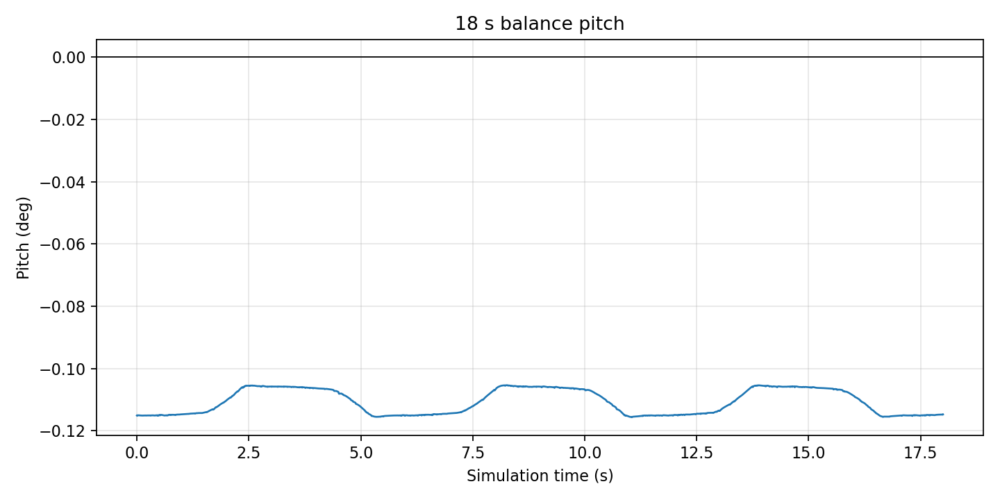

# wheel_leg_controller

第三篇 ROS 2 大作业的独立控制节点。`wheel_leg_sim` 负责 MuJoCo 物理步进，本包只负责
控制律计算，通过 ROS 2 话题交换状态和六路执行器力矩。

## 控制结构

```text
/imu + /joint_states
  -> 四元数转 roll/pitch/yaw
  -> 左右腿五连杆正运动学（L0、theta）
  -> LQR 状态更新和随腿长变化的 K 矩阵
  -> 腿长 PID + VMC 虚拟力/力矩
  -> /actuator_cmd 六路力矩
```

`/cmd_vel` 和 `/joy` 是命令源。`/joy` 在最近 0.5 s 内有消息时优先，超时后自动回到
`/cmd_vel`。直线行驶时使用 IMU yaw 做航向保持；有角速度指令时由角速度指令接管。

仿真器是一条 `/actuator_cmd` 推进一个 2 ms 物理步，所以控制器每收到一条
`/joint_states` 只发布一条力矩指令，保证控制周期与 LQR 的 `dt=0.002 s` 一致。

## 文件

| 文件 | 用途 |
| --- | --- |
| `wheel_leg_controller/wheel_leg_controller.py` | ROS 2 节点、状态处理和控制主链 |
| `wheel_leg_controller/vendor/vmc_cal.py` | 五连杆正运动学、VMC 力矩映射 |
| `wheel_leg_controller/vendor/lqr_update.py` | LQR 状态更新和 K 多项式 |
| `wheel_leg_controller/vendor/roll_leg_control.py` | 根据 roll 分配左右目标腿长 |
| `wheel_leg_controller/vendor/climb_traj.py` | 线速度加速度爬坡 |
| `tools/evaluate_balance.py` | 统计平衡时长、pitch、腿长并输出 CSV |
| `tools/evaluate_bonus.py` | 验收 3 m、合成 `/joy`、优先级回退 |
| `tools/plot_balance.py` | 把平衡 CSV 画成 pitch 曲线 |
| `RECORDING_GUIDE.md` | 录制和提交证据的步骤 |

`vendor/` 中的控制公式来自原工程，只调整了文件位置，没有重新推导或修改增益。

## 构建和运行

```bash
source /opt/ros/jazzy/setup.bash
cd ~/Venom-Train/training/02-ros2-wheelleg/Tutorial/ros2_ws
colcon build --symlink-install
source install/setup.bash
```

终端 A：

```bash
ros2 run wheel_leg_sim wheel_leg_sim
```

没有图形界面时：

```bash
ros2 run wheel_leg_sim wheel_leg_sim --ros-args -p viewer:=false
```

终端 B：

```bash
ros2 run wheel_leg_controller wheel_leg_controller
```

不要在同一个工作区同时启动 `wheel_leg_bridge`，它会和 `wheel_leg_sim` 重复发布
`/imu`、`/joint_states`。

## 主要参数

| 参数 | 默认值 | 说明 |
| --- | ---: | --- |
| `wheel_radius` | `0.06 m` | 轮半径 |
| `target_length` | `0.10 m` | 目标虚拟腿长 |
| `max_velocity` | `0.60 m/s` | `/cmd_vel` 和 `/joy` 的线速度限幅 |
| `wheel_torque_limit` | `2.00 N·m` | 轮力矩限幅，与模型执行器上限一致 |
| `leg_torque_limit` | `1.80 N·m` | 腿关节力矩限幅 |
| `joy_timeout` | `0.50 s` | `/joy` 超时回退时间 |
| `joy_deadzone` | `0.10` | 摇杆死区 |
| `joy_linear_scale` | `0.60 m/s` | 左摇杆满量程线速度 |
| `joy_angular_scale` | `2.00 rad/s` | 右摇杆满量程角速度 |
| `yaw_heading_kp` | `2.00` | 直线航向保持比例增益 |
| `yaw_heading_limit` | `0.60 rad/s` | 航向保持角速度限幅 |

腿长 PID 为 `kp=700, ki=0, kd=5`，yaw PID 为 `kp=0.5, ki=0, kd=1.0`，均沿用原工程。
K 矩阵由 `lqr_update.py` 的三次多项式按当前 `L0` 每一步重算。

`/joy` 使用 Xbox 360 常见布局：

| 操作 | 输入 | 效果 |
| --- | --- | --- |
| 左摇杆上下 | `axes[1]` | 前进/后退 |
| 右摇杆左右 | `axes[3]` | 左转/右转 |
| RB / LB | `buttons[5]` / `buttons[4]` | 目标腿长 ±0.005 m |

实机使用标准 `joy` 包即可：

```bash
sudo apt install -y ros-jazzy-joy
ros2 run joy joy_node
ros2 topic echo /joy --once
```

## 验收要求

官方教程第 5.7 节要求：

- 原地平衡至少 5 s，机体 pitch 偏差小于 10°；
- 加分项：平衡状态下以 0.3 m/s 前进 3 m 不摔，并可选做加速度限制、推扰和 `/joy`。

官方教程第 5.8 节要求提交：

- 新包 `src/wheel_leg_controller/`（`ament_python`），`colcon build` 通过；
- README 说明控制结构、K/参数来源、实测平衡时长和 pitch 曲线；
- 一段 10–20 s 录屏，或包含 `/imu`、`/joint_states`、`/actuator_cmd` 的 ros2 bag。

具体录制步骤见 [RECORDING_GUIDE.md](RECORDING_GUIDE.md)。本文档中的实测数据和曲线来自
当次运行，不使用调试阶段的旧 CSV 作为最终证据。

## 我的实测

- 测试环境：Ubuntu 24.04 + ROS 2 Jazzy；数据来自 18 s bag 回放
- 平衡时长：18.0 s（前 5 s 作为稳定期）
- 稳定期最大绝对 pitch：0.116°
- RMS pitch：0.111°
- 终点 pitch：-0.115°
- 虚拟腿长范围：98.525–98.531 mm



## 爬坡调试记录

默认场景有 5 段坡，段与段之间约有 16 cm 落差。调试时遇到并解决了两个问题：

1. **轮力矩饱和。** 原来的 `wheel_torque_limit=1.5 N·m` 在连续坡上会打满，机器人爬不上去；
   模型执行器允许 `2.0 N·m`，所以默认值改为 `2.0 N·m`。
2. **坡上跑歪。** 原代码把 `angular_velocity.x` 当作 yaw，但 `x` 是横滚角速度，`z` 才是
   偏航角速度。坡上单侧轮先接触时，错误反馈会让机器人越跑越歪。现在 yaw 使用
   `angular_velocity.z`，并增加直线行驶航向保持：`yaw_heading_kp=2.0`、
   `yaw_heading_limit=0.6 rad/s`。

速度不能直接降到 `0.3 m/s`：实测 `0.3/0.4 m/s` 会在坡脚因轮力矩不足卡住；
`0.5 m/s` 配合航向保持可以连续通过 5 段坡。一次 GUI 验证结果为行程约 `6.5 m`，
最大绝对 pitch 约 `24.1°`，最大绝对 yaw 约 `3.6°`，未翻车。目标腿长保持 `0.10 m`，
因为当前机构下限就是 `0.10 m`，没有继续降低重心。

## 提交链接

- 仓库：https://github.com/Belle1Yip/training
- 控制包：`02-ros2-wheelleg/Tutorial/ros2_ws/src/wheel_leg_controller`
- 证据文件夹（bag、平衡/3 m/5 段坡录屏）：https://dcn6ta3td79t.feishu.cn/drive/folder/JbnEfAjAilU5rBdOuJIcYPSHnbg?from=from_copylink

## 平衡统计和曲线

```bash
source /opt/ros/jazzy/setup.bash
cd ~/Venom-Train/training/02-ros2-wheelleg/Tutorial/ros2_ws
source install/setup.bash
python3 src/wheel_leg_controller/tools/evaluate_balance.py \
  --duration 20 --settle 5 --output /tmp/balance_metrics.csv

python3 src/wheel_leg_controller/tools/plot_balance.py \
  --input /tmp/balance_metrics.csv \
  --output src/wheel_leg_controller/doc/balance_pitch.png
```

把 `evaluate_balance.py` 输出的 `duration_s`、`max_abs_pitch_deg` 等数字写进 README 的
“我的实测”一节。

## 常见问题

1. **站桩时不要每一步更新 `x_b_set`。** 只在运动时让它跟随轮里程计；否则位置误差恒为 0，
   机器人能站住但会一直滑走。
2. **左右轮/腿的安装方向不同。** 轮速和轮位置先取共模量，右腿 LQR 传入相反数，最后左右轮
   力矩符号也不同，不要直接统一。
3. **`vmc_cal.py` 中 `d_L_0`、`d_phi_0`、`d_alpha` 为 0 是原工程行为。** 照原样保留，
   这不是本次作业需要修复的 bug。
4. **IMU 的 yaw 轴是 `angular_velocity.z`，不是 `x`。** `x` 是横滚角速度；用错会导致坡上
   越跑越歪。
5. **坡间有约 16 cm 落差。** 0.3/0.4 m/s 可能在坡脚卡住；默认障碍场景连续通过时可使用
   `0.5 m/s`，平地 3 m 验收仍按 0.3 m/s。

## 测试

```bash
source /opt/ros/jazzy/setup.bash
cd ~/Venom-Train/training/02-ros2-wheelleg/Tutorial/ros2_ws
colcon test --packages-select wheel_leg_controller
colcon test-result --verbose --test-result-base build/wheel_leg_controller
```
